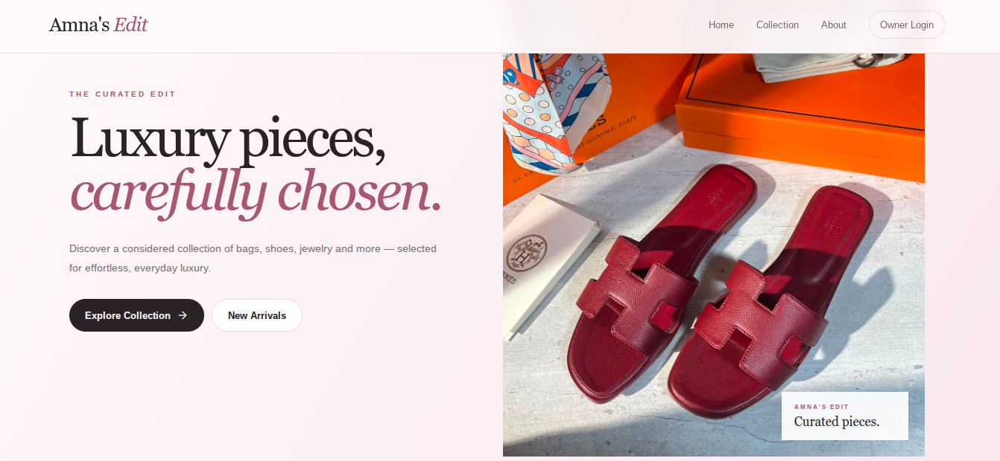
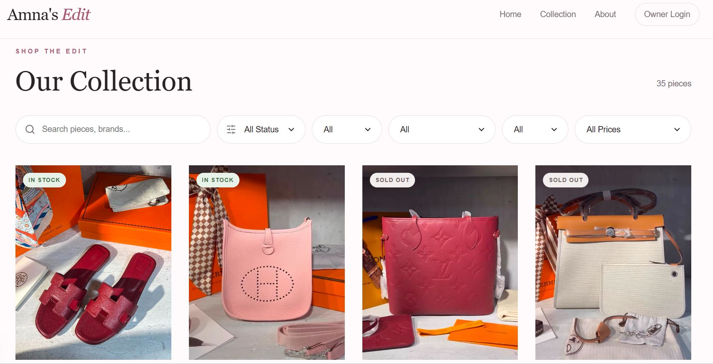
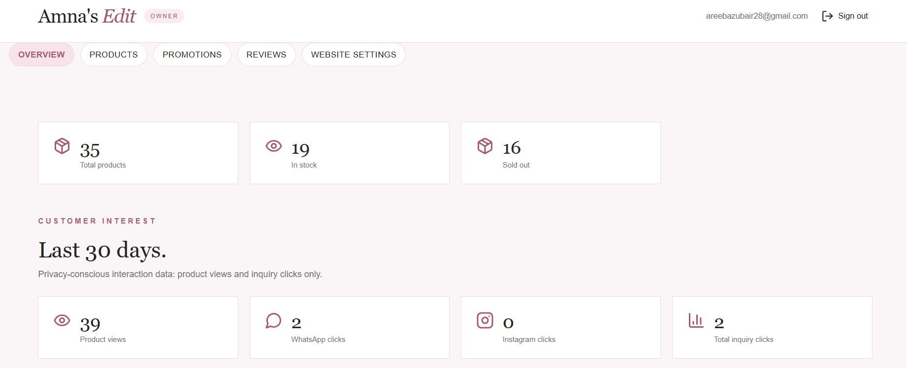
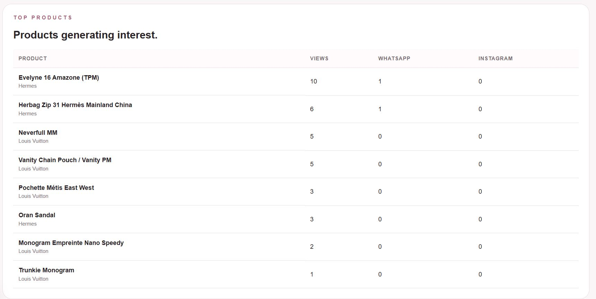
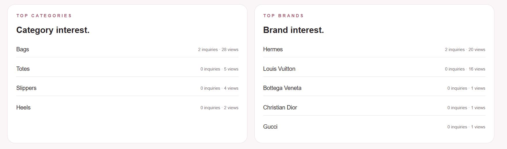
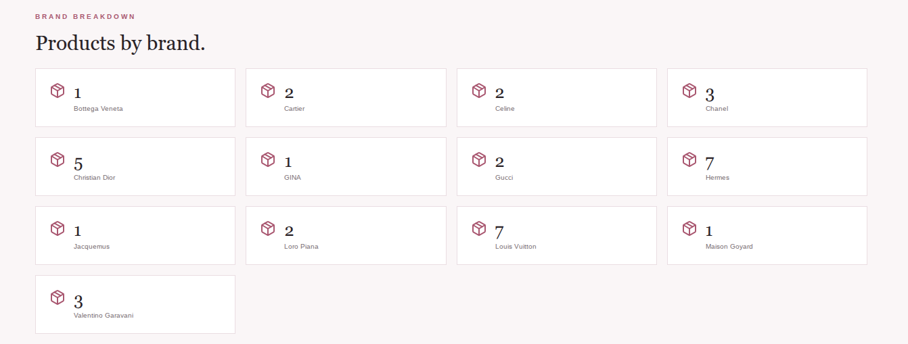
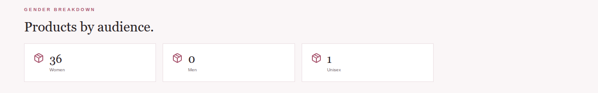

# Amna's Edit

**A curated fashion storefront and product-management platform, built around direct customer enquiries.**

Amna's Edit is a full-stack web application built for browsing curated fashion products, exploring variants, discovering promotions, and contacting the business directly. Featured products rotate in the homepage hero, and visitors can explore color variants before sharing or enquiring about a product. The platform uses direct enquiries rather than an online cart or checkout.

**Live website:** [amnas-edit.vercel.app](https://amnas-edit.vercel.app)  

## Preview

| Storefront | Product collection |
| --- | --- |
|  |  |

**Owner dashboard**



<details>
<summary>Additional dashboard screenshots</summary>






</details>

## Features

### Customer experience

- Responsive home page, collection, product pages, and policies page.
- Search and filters for product status, category, brand, gender, and price.
- Product image galleries and color/variant information, including variant-specific content where configured.
- Availability labels for **In Stock** and **Sold Out** products.
- Featured-product carousel on the homepage, with automatic rotation and manual navigation.
- Native **Share Product** action with a copy-link fallback; color selection is preserved in shared links.
- Color-specific product-page previews for WhatsApp and other services that read Open Graph metadata, subject to platform caching.
- Related-product recommendations.
- Scheduled promotions and visible promotional pricing.
- Customer ratings and reviews, subject to moderation.
- Direct WhatsApp product enquiries with selected-color context.
- Instagram enquiry workflow with a copy-ready product message and link to the configured Instagram destination; Instagram does **not** reliably support prefilled standard DMs.
- No integrated checkout or payment capture.
- Search-engine and social-sharing metadata, sitemap, and robots configuration.

### Owner dashboard

Authenticated owners can access these protected sections:

| Route | Purpose |
| --- | --- |
| `/admin` | Product overview and interaction analytics |
| `/admin/products` | Product listings, photos, color variants, pricing, availability, and catalogue filters |
| `/admin/promotions` | Scheduled promotions and discount rules |
| `/admin/reviews` | Review approval, visibility, and moderation |
| `/admin/settings` | Brand, category, contact, content, and policy settings |

The dashboard provides product management, controlled image uploads, catalogue search and filters, featured-product selection, site configuration, and aggregate product-interest reporting. Multiple products can be featured; eligible featured products rotate through the home hero. Owners authenticate through Supabase Authentication; public visitors do not have access to administration routes.

### Analytics

The owner overview reports recent product-interest activity, including product views, enquiry clicks, and product/category/brand rankings. These metrics represent website interactions, **not completed purchases or revenue**.

## Tech stack

| Layer | Technology |
| --- | --- |
| Application | Next.js 16 (App Router), React 19, TypeScript |
| UI | CSS, Lucide React icons |
| Backend and database | Supabase, PostgreSQL |
| Authentication and authorization | Supabase Auth, PostgreSQL Row Level Security (RLS) |
| Image storage | Supabase Storage |
| Testing | Node.js built-in test runner, Playwright, axe-core |
| Hosting | Vercel |

## Project structure

```text
app/
  admin/               Protected dashboard pages
  api/                 Analytics and review endpoints
  collection/          Product catalogue
  login/               Owner sign-in
  policies/            Store policies
  products/[slug]/     Shareable product detail pages
  globals.css          Global and responsive styling
components/            Storefront, gallery, dashboard and shared UI
hooks/                 Reusable React hooks
lib/                   Supabase clients and application utilities
supabase/              Database schema and incremental SQL migrations
tests/
  browser/             Playwright customer, owner and accessibility tests
  project-contracts.test.mjs
  smoke.mjs
docs/                   Screenshots and production-readiness checklist
types/                  Shared TypeScript types
proxy.ts                Protected-route session middleware
playwright.config.mjs   Desktop and mobile Chromium configuration
.env.example            Placeholder environment-variable template
```

## Getting started

### Prerequisites

- Node.js and npm compatible with Next.js 16 (Node.js 20.9 or newer).
- A Supabase project, with the database and storage configured for the application.

### 1. Clone and install

```bash
git clone https://github.com/AreebaZubair28/amnas-edit.git
cd amnas-edit
npm ci
```

### 2. Configure environment variables

Copy `.env.example` to `.env.local` and provide the values for your own Supabase project and business contact details.

```env
NEXT_PUBLIC_SUPABASE_URL=https://YOUR-PROJECT.supabase.co
NEXT_PUBLIC_SUPABASE_PUBLISHABLE_KEY=YOUR_SUPABASE_PUBLISHABLE_KEY
NEXT_PUBLIC_WHATSAPP_NUMBER=923XXXXXXXXX
NEXT_PUBLIC_INSTAGRAM_URL=https://instagram.com/YOUR_INSTAGRAM
NEXT_PUBLIC_SITE_URL=http://localhost:3000

# Server-only secrets: never add a NEXT_PUBLIC_ prefix.
SUPABASE_SERVICE_ROLE_KEY=YOUR_SUPABASE_SERVICE_ROLE_KEY
REVIEW_RATE_LIMIT_SECRET=REPLACE_WITH_A_LONG_RANDOM_SECRET
```

Use the actual deployment URL for `NEXT_PUBLIC_SITE_URL` in production. Never commit `.env.local` or share service-role credentials.

### 3. Prepare Supabase

The `supabase/` folder contains the initial schema and subsequent compatibility, security, promotion, review, variant, and analytics migrations. The exact set of migrations to apply depends on the current database state.

- For a **new** database, begin by reviewing `supabase/schema.sql` in the Supabase SQL Editor, then apply the relevant follow-up migrations in dependency order.
- For an **existing** database, **do not rerun all SQL files blindly**. Review the current schema and apply only the migrations that are missing.
- Configure Supabase Storage, Authentication, and RLS policies as required by the application.
- Create an owner using Supabase Authentication, then assign their existing Auth user ID the `owner` role in `public.profiles` using a privileged SQL session:

```sql
insert into public.profiles (id, role)
values ('YOUR-AUTH-USER-UUID', 'owner')
on conflict (id) do update set role = 'owner';
```

Never assign owner access from untrusted client input.

### 4. Start the application

```bash
npm run dev
```

Open [http://localhost:3000](http://localhost:3000).

## Verification and testing

Available commands:

| Command | Purpose |
| --- | --- |
| `npm run lint` | ESLint checks |
| `npx tsc --noEmit` | TypeScript type checking |
| `npm run build` | Optimized production build |
| `npm test` | Source and project-contract tests |
| `npm run test:smoke` | Read-only HTTP and security-header smoke checks |
| `npm run test:e2e` | Playwright browser tests |

To run browser tests for the first time:

```bash
npx playwright install chromium
npm run dev
```

In **another terminal**, run:

```bash
npm run test:e2e
```

Playwright covers desktop Chromium and a mobile Chromium device profile, including storefront journeys, accessibility checks, and optional authenticated **read-only** owner journeys.

For owner tests, set `ADMIN_E2E_EMAIL` and `ADMIN_E2E_PASSWORD` in your **local terminal environment**. Do not store credentials in the repository. Authenticated owner tests are intentionally restricted to localhost and do not perform database writes.

**Verification history:** An earlier release passed ESLint, TypeScript, a production build, and **30 Playwright checks** (October 2026). The most recent sharing, admin-filter, and featured-carousel changes require a fresh run of these checks before deployment. Automated accessibility results do not guarantee full WCAG conformance.

See [production readiness checklist](docs/PRODUCTION_READINESS.md) for additional verification and release steps.

## Security and privacy considerations

- Owner-only administration is protected using Supabase authentication, middleware/session verification, and database authorization rules.
- Server-side credentials are kept separate from variables exposed to the browser.
- Review submission includes server-side protections; moderation controls determine public visibility.
- The application configures Content Security Policy and other HTTP response headers.
- Aggregate interaction analytics are intended for product-interest reporting, not customer payment processing.

**Important:** A successful build or automated test run is not a security audit. Before a production release, review Supabase RLS/storage policies, environment settings, dependency advisories, and database migrations.

## Deployment

The project is deployed with **Vercel**.

1. Push the project to GitHub without `.env.local` or other credentials.
2. Connect the repository to a Vercel project.
3. Configure the required environment variables for the Production environment (including the server-only secrets).
4. Deploy and confirm the build is successful.
5. Check home, featured-product rotation, collection filters, policies, color-specific product links and previews, native sharing, WhatsApp/Instagram enquiries, and protected owner navigation on the deployed site.
6. Review the [production readiness checklist](docs/PRODUCTION_READINESS.md) for post-deployment checks.

## Release verification checklist

Before publishing updates, run:

```bash
npm run lint
npx tsc --noEmit
npm test
npm run build
npx playwright test
```

Then verify at least two featured products in the homepage carousel, desktop/mobile gallery sizing, a color-specific share link, the admin product filters, and protected administration access. Run the read-only smoke checks against the deployed domain after Vercel shows the release as ready.

## Project scope

Amna's Edit is a **catalogue and enquiry platform**, not a payment-processing marketplace. Cart, online checkout, payment capture, and order fulfilment are outside the implemented scope.

---

*Amna's Edit — a curated shopping experience, from discovery to enquiry.*
